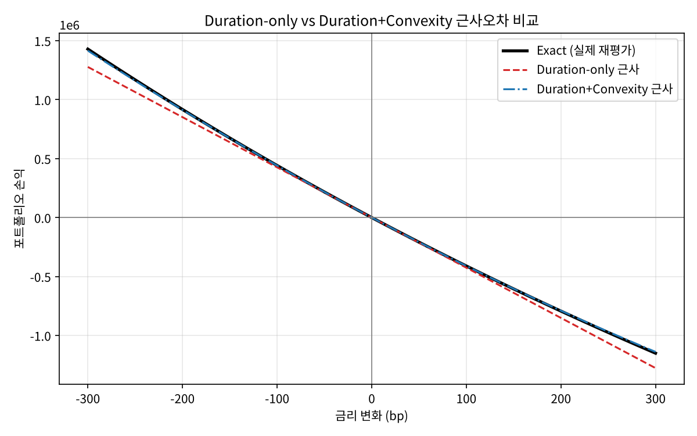
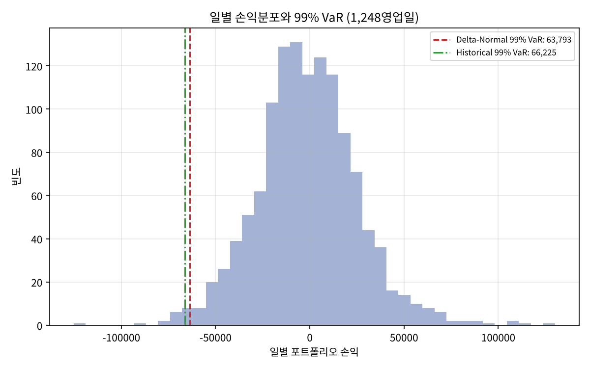

# 채권 포트폴리오 금리위험 측정

미국 국채 현금흐름으로 포트폴리오 가격을 직접 산출하고, **Modified Duration·Convexity 근사의 오차**와 **두 가지 VaR 방법론(Delta-Normal / Historical Simulation)**을 약 5년치 실제 금리 데이터로 비교·백테스트한 프로젝트입니다.

📄 전체 정리: [`docs/bond_portfolio_rate_risk.pdf`](docs/bond_portfolio_rate_risk.pdf)

## 연구배경

- Duration은 가격-수익률 관계를 직선으로 근사하므로, 금리 변동이 클수록 실제 가격 변화와의 오차가 커집니다. Convexity가 이 오차를 얼마나 줄이는지 직접 계산해 확인하고 싶었습니다.
- 금리위험을 VaR 하나로 요약할 때, 정규분포를 가정하는 Delta-Normal과 실제 과거 금리 변화를 쓰는 Historical Simulation은 결과가 달라질 수 있고, 관측 기간(특히 2022년 급등기 포함 여부)에도 크게 좌우됩니다.

## 데이터

| 항목 | 내용 |
|---|---|
| 출처 | FRED (St. Louis Fed) `DGS2`, `DGS5`, `DGS10` |
| 기간 | 2021-09-10 ~ 2026-09-10, 결측(휴장일) 제거 후 1,248개 일별 변화 |
| 포트폴리오 | 2026-09-08 par yield 기준 2Y(4.39%) / 5Y(4.57%) / 10Y(4.80%) 각 3,000,000 동일가중 |

## 방법

1. **가격**: 반기이표 par bond의 현금흐름을 YTM으로 할인(DCF)
2. **Duration·Convexity**: Macaulay → Modified Duration, 현금흐름 기반 Convexity. 포트폴리오는 시장가치 가중평균
3. **시나리오**: ±10/50/100/200bp 평행이동에서 실제 재평가 vs Duration-only vs Duration+Convexity 비교
4. **VaR (99%, 1일)**
   - Delta-Normal: Dollar Duration × 평균 금리변화 표준편차 × z
   - Historical Simulation: 1,248일의 실제 텐서별 금리변화를 근사식에 대입한 손익분포의 하위 1% 분위수
5. **백테스트**: 실제 손실이 VaR을 초과한 날의 비율 (99% VaR이면 이론상 약 1%)

## 결과

포트폴리오: 총 시장가치 9,000,000 / Modified Duration 4.73 / Convexity 34.07

**근사오차 (포트폴리오 손익, 단위 동일)**

| 금리충격 | Exact 손익 | Duration-only 오차 | Duration+Convexity 오차 |
|---|---|---|---|
| -200bp | 916,515 | -65,195 | -3,862 |
| -100bp | 441,463 | -15,804 | -470 |
| +100bp | -410,773 | -14,886 | 447 |
| +200bp | -793,475 | -57,845 | 3,488 |



**VaR 비교 및 백테스트 (1,248영업일)**

| 방법론 | 99% 1일 VaR | VaR 초과일수 | 초과비율 |
|---|---|---|---|
| Delta-Normal | 63,793 | 17일 | 1.36% |
| Historical Simulation | 66,225 | 13일 | 1.04% |



- 두 VaR의 차이는 약 3.8%로 근접했습니다.
- Delta-Normal의 초과비율(1.36%)이 이론값 1%를 웃돌아, 정규분포 가정이 꼬리 위험을 다소 낮게 본다는 점을 확인했습니다.
- Historical의 1.04%는 같은 표본으로 계산한 **in-sample** 결과이므로 독립 검증으로 해석하지 않았습니다.
- **관측기간 민감도**: 2026년 1~9월(171일)만 썼을 때 VaR은 43,714 / 45,836이었으나, 2022년 급등기를 포함한 5년 데이터에서는 63,793 / 66,225로 약 45% 커졌습니다.

## 한계 및 개선 방향

| 한계 | 개선 방향 |
|---|---|
| Delta-Normal이 평균 금리변화 단일 팩터(평행이동) 가정 | 2Y/5Y/10Y 공분산 행렬을 이용한 다변량 Delta-Normal |
| Historical 백테스트가 in-sample | 롤링 윈도(직전 250일) 기반 out-of-sample 백테스트 |
| 일별 손익을 Duration+Convexity 근사로 계산 | 매일 완전재평가하는 방식과 비교 |
| par bond 이론가 기준 (유동성·베이시스 미반영) | 실제 종목 시장가 데이터 연동 |
| VaR은 꼬리 손실 크기를 알려주지 못함 | Expected Shortfall 추가 |

## 실행 방법

```bash
pip install -r requirements.txt
python main.py        # 결과가 outputs/ 에 저장됩니다
```

한글 폰트(맑은 고딕, AppleGothic, 나눔고딕 등)가 없으면 그래프 라벨이 영문으로 표시됩니다.

## 폴더 구조

```
bond_pricing.py   채권 가격 / Duration / Convexity
portfolio.py      포트폴리오 구성
scenario.py       금리 시나리오 손익, 근사오차
var_analysis.py   Delta-Normal / Historical Simulation VaR
main.py           전체 파이프라인 실행
data/             FRED 일별 금리 (2Y/5Y/10Y)
outputs/          결과 표, 그래프, 요약
docs/             프로젝트 정리 PDF
```
